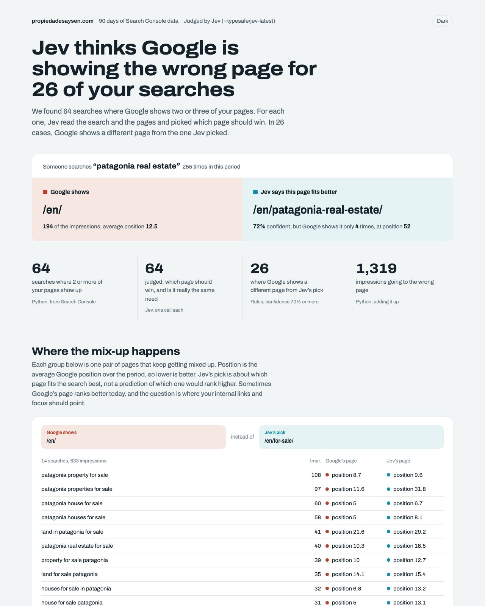

# Jev Cannibalization Check

Find the searches where Google shows the wrong one of your pages, from your own Search Console data, for less than a cent.

This skill for Claude Code takes your Search Console data and finds every search where Google splits impressions between two or more of your pages. It asks **Jev** (TypeSafe AI's decision model) which page should own each search, then hands you a report.



## What it does

1. **Finds real overlap.** Every search where two or more of your pages each got impressions. That's cannibalization Google is actually showing, not a guess from page titles. This step is free, in Python.
2. **Reads each page** involved: title, H1, meta description, opening text.
3. **Asks Jev**, one call per search: which page gives this searcher what they want? Do the pages really serve the same need? What should you do about it? Jev answers with probabilities, not text.
4. **Applies rules you control:** "wrong page winning", "splitting signals", "right page already winning", or "Jev not sure, review it". Jev's suggested fix is only used when it's 70%+ confident.
5. **Builds the report:** the biggest mix-ups grouped by page pair, and every search with exactly what Jev was shown.

On a real property site (90 days of data): 64 searches judged, 26 where Google shows a different page from Jev's pick, **$0.003** in Jev calls.

## Install

You need [Claude Code](https://claude.com/claude-code), Python 3.10+ and an [OpenRouter](https://openrouter.ai/keys) API key with a little credit.

```bash
git clone https://github.com/NicoSKOOL/jev-cannibalization ~/.claude/skills/jev-cannibalization
pip install -r ~/.claude/skills/jev-cannibalization/requirements.txt

mkdir -p ~/.config/jev-seo
echo 'OPENROUTER_API_KEY=sk-or-YOUR-KEY' > ~/.config/jev-seo/.env
chmod 600 ~/.config/jev-seo/.env
```

## Get your Search Console data

You need rows with **both query and page**, ideally the last 90 days.

- **Easiest:** connect Search Console to OpenSEO and add its MCP server to Claude. Then just ask Claude to run a cannibalization check on your site, and it pulls the data itself with `get_search_console_performance`.
- **Or** use any CSV with Query, Page, Clicks, Impressions and Position columns.

## Use

In Claude Code: "Run a cannibalization check on example.com." Or directly:

```bash
python ~/.claude/skills/jev-cannibalization/scripts/run.py gsc.csv --domain example.com
```

The report is saved to `./jev-cannibalization/example.com/out/cannibalization.html` and opens by itself.

## Good to know

- **"Wrong page" means "fits the search worse", not "ranks worse".** Sometimes Google's page ranks better today. The usual fix is to point internal links and on-page focus at the better page, not to redirect.
- **Jev's confidence is its own estimate.** Treat it as a way to sort what you review, not as proof.
- **In testing, Jev was confident about which page should win but rarely about the fix.** Merges and redirects stay your decision.
- **Runs vary a little.** Jev isn't deterministic: 1 of 64 outcomes changed between two runs. Answers are cached so each report is reproducible.
- **Nothing here measures rankings.** To test a change, compare the pages you changed against similar ones you didn't, in Search Console, after 60 to 90 days.
- **Client data:** TypeSafe's API terms are still early access. Check them before running this on sites you don't own.

Also see [jev-internal-links](https://github.com/NicoSKOOL/jev-internal-links) and [jev-chatgpt-visibility](https://github.com/NicoSKOOL/jev-chatgpt-visibility).

## License

MIT
