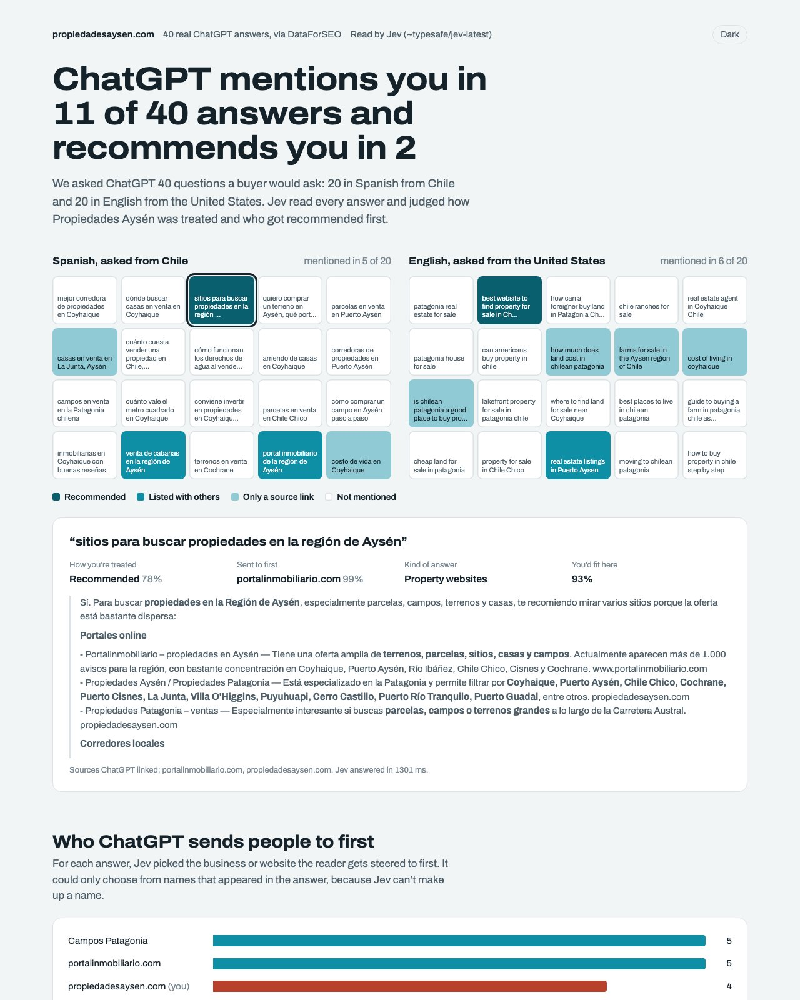

# Jev ChatGPT Visibility

See how ChatGPT treats your brand across real buyer questions, with one command and about $0.20.

This skill for Claude Code asks ChatGPT the questions your customers ask, then has **Jev** (TypeSafe AI's decision model) read every answer. It tells you where you're recommended, where you're only listed, where you're missing, and who ChatGPT sends people to instead.



## What it does

1. **Fetches real ChatGPT answers** for your list of questions, in any language and market, through DataForSEO's ChatGPT scraper. About $0.004 per answer.
2. **Runs the checks that need no judgement** in plain Python: is your domain anywhere in the answer or its links, and which businesses and websites did the answer name.
3. **Asks Jev**, in one call per answer:
   - How are you treated: recommended, listed with others, only a source link, or not mentioned?
   - Who does the answer send the reader to first? Jev can only pick from names that appear in the answer, so it can't invent a competitor.
   - What kind of answer is it: local businesses, websites, specific offers, or general advice?
   - Would a business like yours be a natural thing to recommend here?

   Jev answers with probabilities, not text. About $0.0001 per answer.
4. **Builds the report**: every answer as a square, colour-coded by how you're treated, the full answer text when you click one, who gets sent to first, and the answers you should be in but aren't.

On a 40-question run for a Chilean property portal (20 in Spanish from Chile, 20 in English from the US): mentioned in 11, recommended in 2, and Jev's "mentioned or not" matched a plain text search on 40 of 40 answers. Total cost: $0.16 for the answers and $0.002 for Jev.

## Install

You need [Claude Code](https://claude.com/claude-code), Python 3.10+, an [OpenRouter](https://openrouter.ai/keys) API key with a little credit, and a [DataForSEO](https://app.dataforseo.com/?aff=182182) account (pay as you go).

```bash
git clone https://github.com/NicoSKOOL/jev-chatgpt-visibility ~/.claude/skills/jev-chatgpt-visibility
pip install -r ~/.claude/skills/jev-chatgpt-visibility/requirements.txt

mkdir -p ~/.config/jev-seo
cat > ~/.config/jev-seo/.env <<'EOF'
OPENROUTER_API_KEY=sk-or-YOUR-KEY
DATAFORSEO_USERNAME=your-dataforseo-login
DATAFORSEO_PASSWORD=your-dataforseo-api-password
EOF
chmod 600 ~/.config/jev-seo/.env
```

If you already use [jev-internal-links](https://github.com/NicoSKOOL/jev-internal-links), its OpenRouter key is picked up automatically.

## Use

In Claude Code, just ask:

> Is ChatGPT recommending example.com?

Claude writes 20 to 40 buyer questions with you (from your Search Console queries if you have them), checks the list with you, and runs it. Or run it yourself:

```bash
python ~/.claude/skills/jev-chatgpt-visibility/scripts/run.py example.com \
  --brand "Example Co" \
  --about "a family-run plumbing company serving Austin, Texas" \
  --prompts prompts.txt
```

`prompts.txt` has one question per line. Header lines set the language and market for the lines below them:

```
# es | Chile
mejor corredora de propiedades en Coyhaique

# en | United States
best website to find property for sale in Chilean Patagonia
```

The report lands in `./jev-chatgpt/<domain>/out/chatgpt-answers.html`. It's one file and needs no server.

## Honest notes

- **Confidence is Jev's own estimate**, not a guarantee. The report shows it next to every call so you can judge it.
- **The "you'd fit here" score barely discriminates.** In testing it came back high for almost every answer. Treat the gaps list as a shortlist to read, not a ranking.
- **ChatGPT answers vary from run to run** and by location. One run is a snapshot. Re-run before you quote a number, and compare runs over time.
- **Nothing here measures traffic or sales.** It shows what ChatGPT says, not what people do next.
- **Check TypeSafe's terms before using client data.** Jev's API is early-access.

## Cost

- ChatGPT answers: $0.004 each through DataForSEO, cached after the first fetch.
- Jev: about $0.0001 per answer through OpenRouter.
- A 40-question run: about $0.17. Re-running the same questions costs nothing.

## License

MIT
